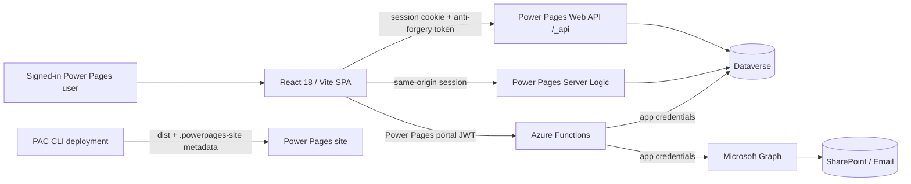

# GCP Nexus project context report

**Audit date:** 2026-07-24  
**Repository:** `GCP-SPA-final-version`  
**Branch inspected:** `master`  
**HEAD inspected:** `08b70bb` (`Deploy to prod (PowerPagesProduction / GCP Nexus)`)  
**Worktree note:** `src/pages/VerifyData.tsx` had a pre-existing local
modification and was not changed by this audit.

This is the living onboarding and architecture document for the repository.
Update it when architecture, integration boundaries, deployment behavior, or
major implementation decisions change.

**Implementation update — 2026-10-15:** The approved request-history, printing,
form, and transactional booking changes were developed on
`feature/request-history-print-rescheduling`, based on `03681c9`. At the initial
rollout they had not yet been committed or pushed. The shared Function backend was published with explicit
approval, and the requested GCP-Developer SPA/permissions were uploaded and the
dev site restarted successfully. Deployed bundle hashes and permission records
match the build/design. The user chose to finish with deployment checks only;
signed-in runtime checks were skipped. See
[the rollout record](docs/request-history-booking-rollout-2026-10-15.md) for
verification, configuration prerequisites, and the signed-in smoke-test matrix.
The subsequent local presentation follow-up hides the new Request Detail
booking/history panels and stops history-only loading, while retaining the
original signing/workflow actions and requester/admin Edit Booking through the
engagement form. Print follows the remaining displayed sections. The follow-up
upload to the explicitly authorized dev site completed successfully (74/74
events); its restart and live verification command was declined by the approval
prompt and did not run. See the rollout record's presentation follow-up section.
The later lookup-write/booking-guard release includes this same presentation
change and completed the dev restart, live settings/permissions readback, and
bundle verification; see the lookup-write incident record for current status.
The audit header above describes the original July audit, not today's HEAD.

**GitHub publication — 2026-10-16:** The user requested committing and pushing
the verified October release to `wajidashraf/GCP-SPA-final-version` on
`feature/request-history-print-rescheduling`. The release includes source,
Power Pages metadata/bundle, regression tests and rollout evidence. Machine-local
credentials, staging packages and browser captures are excluded. The published
production state is recorded in `docs/alm/last-deploy.json`.

## Executive summary

**Booking follow-up — 2026-10-16:** Portal-token-authorized booking reads now
bypass the Power Pages cache for original requesters and administrators; admin
slot/engagement management uses the same fresh source. The current booking is
separate from availability counts. Creation guards the request before creating
the engagement because existing synchronous workflows update its parent.
Reschedule/cancel compare the editor's saved engagement version. See the
[cache/workflow incident](docs/booking-cache-workflow-fix-2026-10-16.md) for
evidence, validation and rollout status. Existing workflows, schema, permissions
and business records are unchanged by this fix.

**Requests list follow-up — 2026-10-16:** The list refreshes each loaded page's
request statuses before applying client filters. A minimal authenticated batch
read evaluates the selected site's deployed request-read grants and returns only
authorized ID/status pairs. Existing Global/Contact/Account scopes and implicit
authenticated membership are preserved; there is no client status override or
data repair. See the [list-status incident](docs/request-list-status-refresh-2026-10-16.md)
for validation and rollout status.

GCP Nexus digitizes GCP/GCPC contract-procurement request submission, review,
engagement, acceptance, acknowledgement, endorsement, role management, and
reporting workflows. It is a React/Vite single-page application hosted as a
Microsoft Power Pages code site, backed by an existing Dataverse schema.

The codebase has three execution surfaces:

1. The browser SPA in `src/`.
2. Power Pages and Dataverse metadata in `.powerpages-site/`, including
   same-origin server logic.
3. An Azure Functions backend in `api/` for integrations that need server-side
   credentials.

The most important architectural constraint is that the Dataverse data model is
owned outside this repository. Repository types and mappings mirror that schema;
they do not define it.

## System architecture



### Browser SPA

- Entry points: `src/main.tsx` and `src/App.tsx`.
- Framework: React 18, React Router 6, strict TypeScript, Vite 5.
- UI: Bootstrap/React Bootstrap, shared form components, repository CSS, and
  `lucide-react` icons.
- Charts: `recharts`.
- Routing includes submission, request list/detail/edit, verification, review,
  engagement, acceptance/letters, administrative management, profile, and
  dashboard pages.
- `RequireRole` gates sensitive routes in the UI, but server-side permissions
  remain authoritative.

### Dataverse access

- `src/shared/powerPagesApi.ts` is the central same-origin Web API client.
- It obtains and caches the Power Pages anti-forgery token, invalidates it on the
  relevant 403, retries 429/5xx responses, and provides OData helpers.
- Table-specific CRUD belongs under `src/shared/services/`.
- Clean frontend types live under `src/types/`.
- Dataverse choices live under `src/data/`.
- Form-to-parent/child/grandchild mappings are documented in `mapping.md` and
  implemented in each `src/forms/<matter>/api.ts`.

### Authentication and authorization

- Portal login/session state comes from
  `window.Microsoft.Dynamic365.Portal` through `src/services/authService.ts` and
  `src/context/AuthContext.tsx`.
- Localhost uses a mock portal user; `/_api`, `/_layout`, portal tokens, table
  permissions, and server logic cannot be fully exercised locally.
- Same-origin Dataverse calls use the portal session and anti-forgery token.
- Cross-origin Azure Function calls acquire a Power Pages portal token from
  `/_services/auth/token` through `src/shared/portalToken.ts`.
- `api/src/auth/validateToken.ts` validates portal-token signature, issuer,
  audience/application ID, and contact identity.
- The retired MSAL hidden-iframe design must not be restored. It timed out in the
  sandboxed Power Pages iframe because the nested authentication context could
  not complete reliably.
- UI role visibility is not authorization. Dataverse table permissions,
  Function-side admin checks, and server-logic role checks are the actual
  security controls.

### Azure Functions

The TypeScript Azure Functions project in `api/` currently contains:

- SharePoint file upload through Microsoft Graph.
- Notification email rendering and sending.
- Web-role list/assignment/removal through Dataverse.
- Legacy signatory functions and Dataverse helpers retained after the active
  frontend signatory path moved to Power Pages Server Logic.

The SPA authenticates to these functions with the portal token. The Function
uses server-side application credentials for Graph and Dataverse. The app secret
must never reach the browser.

### Power Pages Server Logic

`.powerpages-site/server-logic/` contains:

- `signatorymembers`: list members; add/remove with an in-code administrator
  check.
- `signatorythresholds`: read thresholds; set with an administrator check.
- `test`: a pre-existing test/example server logic.

`src/shared/signatoryApi.ts` calls the first two through the same-origin
`/_api/serverlogics/*` endpoints. Table permissions remain defense in depth.
See `server-logic/README.md` for the migration rationale and runtime smoke test.

### Power Pages site package

`.powerpages-site/` contains the deployable site metadata:

- website, language, page, template, snippet, and navigation metadata;
- Web API site settings;
- web roles and table permissions;
- server logic;
- a `web-files/` snapshot.

The current SPA must be built to `dist/` and supplied to PAC with
`--compiledPath`. The `web-files/` snapshot can be stale.

## Repository map

| Path | Responsibility |
|---|---|
| `src/App.tsx` | Route topology and route-level role gates |
| `src/pages/` | Route-level workflows and orchestration |
| `src/components/` | Reusable domain and UI components |
| `src/forms/` | Shared fields, multi-step framework, and matter forms |
| `src/forms/<matter>/api.ts` | Create/edit state-to-Dataverse mapping |
| `src/data/` | Canonical Dataverse choice mirrors and UI option helpers |
| `src/types/` | Clean domain and Dataverse request types |
| `src/shared/powerPagesApi.ts` | Same-origin Web API client |
| `src/shared/services/` | Table-specific data access |
| `src/context/AuthContext.tsx` | Portal user/contact/company hydration |
| `src/shared/portalToken.ts` | Portal JWT acquisition for Azure Functions |
| `src/shared/documents.ts` | Persisted document JSON handling |
| `api/src/functions/` | Azure Function HTTP endpoints |
| `api/src/auth/` | Function-call portal-token validation |
| `api/src/dataverse/` | Server-side Dataverse access |
| `api/src/sharepoint/` | Graph/SharePoint upload integration |
| `api/src/email/` | Notification templates and rendering |
| `.powerpages-site/` | PAC-deployable site metadata and server logic |
| `mapping.md` | Form-to-Dataverse field map |
| `contex.md` | Historical business requirements |
| `userguide.md` | End-user request workflow guide |
| `docs/` | Edit rollout and dated permissions audits |

## Business workflow and roles

The historical BRD defines these major roles:

- Requestor: submits and resubmits requests.
- Verifier: validates data/documents and routes or returns requests.
- Reviewer: conducts the GCP/GCPC review and records the decision.
- HOC/Head of GCP: accepts review output and acknowledgement steps.
- Endorser/Head of GCPC: completes endorsement steps.
- Working/Main GCPC: participates in review or receives read access.
- Administrators: manage roles, slots, engagements, signatories, templates, and
  dashboards.

The current status and decision-code reference is in `userguide.md` and
`src/data/requestChoices.ts`. The implementation source wins if the user guide
has not been updated.

## Matter types and form topology

Edit coverage is complete for 13 matter codes representing 14 Dataverse matter
values:

| Code | Matter/form area |
|---|---|
| `RTP` | Registration of Tender & Proposal List |
| `PBL` | Prospective Bidders List |
| `JVP` | JV / Partnership (Dataverse child uses the JVM prefix) |
| `ST/SP` | Submission of Tender / Proposal |
| `CAA` | Client Acceptance of Award |
| `PCCA` | Project Cost / Construction Analysis |
| `PP` | Procurement Plan |
| `VAP` | Vendor Appointment and Procurement |
| `Others` | Shared form for GCPC and GCP "other" values |
| `CPR` | Contract Progress / Procurement Report |
| `CI` | Contractual Issue |
| `R-PCCA` | Revised PCCA |
| `R-PP` | Revised Procurement Plan |

The exact logical names, entity sets, navigation properties, primary-name
quirks, JSON-serialized repeatable fields, and intentionally display-only
uploads are recorded in `mapping.md`.

## Durable implementation decisions

### D-001: Dataverse owns the schema

Do not evolve the database speculatively from frontend code. Choice integers and
logical names must match Dataverse exactly.

### D-002: Choices and business fields are shared

Choice mirrors are canonical in `src/data/`; common business inputs are exported
from `src/forms/index.ts`. This prevents value drift and inconsistent form
behavior.

### D-003: Request detail remains generic and read-only

Editing navigates to the original matter form in edit mode rather than making
the generic detail renderer inline-editable.

### D-004: Edit mode preserves identity and status

For status New (`1`), R (`3`), or RS (`16`), the same form is seeded from the
saved record and PATCHes the parent/child. The original requestor plus
Reviewer, Verifier, and Administrator roles may edit at those statuses.
Logged-in reviewer/verifier/admin identity must never overwrite the original
requestor/company. Submitting edits preserves the current status. Edit is
hidden at all other statuses.

### D-005: RS edits create a re-review substate without changing choices

Verifier selection RS and Reviewer Code 2 both set status and outcome to RS.
Only an edit made while the request is RS creates the re-review substate: after
every edit write succeeds, outcome is repaired to RS and the existing
`gcp_lastupdateddate` field is stamped. Request Detail offers
**Review Resubmission** only when status RS, outcome RS, and the timestamp are
all present. New/R edits preserve status/outcome and do not stamp or notify.
Review has no draft-save operation and final submission checks for a newer edit
before committing its mapped decision.

### D-005: Function calls use Power Pages portal tokens

The portal-token design replaced MSAL in June 2026 because the Power Pages
sandboxed iframe broke hidden-iframe authentication. The Function and SPA must
remain compatible as a pair.

### D-006: Signatory management uses Power Pages Server Logic

Signatory members and thresholds moved from the Azure Function client path to
same-origin server logic in July 2026. Reads are available to authenticated
users; writes fail closed unless the server sees the Administrators role.

### D-007: PAC uploads must use the compiled SPA

`pac pages upload-code-site` must receive the root, `dist` compiled path, and
site name `gcp-nexus`. Restart and role-based smoke testing follow deployment.

### D-009: Incomplete New requests are repairable drafts

The Requests list derives associated-data integrity with batched, lookup-only
queries against each matter-specific child table. A status New (`1`) parent is
shown as **Draft** only when its required associated data is verifiably missing;
the row is non-navigable and exposes only **Edit**. Failed integrity queries are
fail-closed as **Unable to verify** and never offer repair. PBL is complete only
when both its direct PBL child and at least one bidder exist.

Repair mode reuses the existing parent GUID, creates only the missing associated
records, and then PATCHes editable parent fields without changing requestor,
company, submitted timestamp, status, or workflow outcome. A fresh integrity
check immediately before submit prevents duplicate child creation. Ordinary
complete New/R/RS edit behavior is unchanged.

### D-008: HOC acceptance remains resumable until submission

HOC acceptance is available only to the HOC role for the request's company (or
an administrator) while the request is at Complete Review (`6`). Saving the HOC
signature does not complete or lock the acceptance: the signed form remains
editable and can be resumed until **Submit Signed Acceptance** advances the
request to Pending Ack (`9`) or Pending Endorse (`11`). Completed acceptance
documents are read-only and printable. Signature uploads preserve their actual
PNG/JPEG content type, are preview-validated before upload, and SharePoint image
links use direct-download rendering rather than the document-view page.

### D-010: GCPC endorsements are submitted by Endorser/Admin

The Endorser or Administrator owns the GCPC Endorsement Letter action at
Pending Endorse (`11`), with legacy Complete Acceptance (`8`) retained for old
records. Reviewer-only users cannot see or directly open the endorsement route.
The Endorser role is attached to the existing global `gcp_request` workflow
write permission; Authenticated Users are not broadened.

Submission PATCHes only the endorsement letter text, endorsement date, and
Endorsed (`12`) status. Deterministic authorization/validation failures remain
errors. If an uncertain network, throttling, or server response occurs, the SPA
checks the saved request status and treats the operation as successful only when
Endorsed (`12`) is observable. Shared Power Pages Web API errors must always
provide a non-empty message with available HTTP and Dataverse-code context.

Production edge diagnostics on 2026-09-02 identified the legacy embedded HTML
comment marker (`<!--GCP_LETTER:...-->`) as a separate cause of HTTP 403 during
letter PATCH requests. New acknowledgement and endorsement letters therefore
store their re-editable JSON metadata after the plain-text
`GCP_LETTER_METADATA_V2:` marker. The parser remains backward compatible with
the legacy marker so existing saved letters can still be opened and re-saved.

Endorsement **Review No.** is sourced from the request's most recent Completed
(`2`) engagement, ordered by engagement date and then creation time descending.
When that engagement has a non-empty number such as `R02`, the letter displays
it through the existing automatic read-only field behavior. If no Completed
engagement exists, Review No. remains blank and editable. Engagement lookup
errors withhold the letter editor rather than silently enabling manual entry.

### D-011: RTP FR verification conditionally activates its project

Decision date: 2026-09-01.

RTP submission creates a related `gcp_projects` row with
`gcp_projectstatus = 0` (Inactive). When the verifier submits an RTP request as
FR (`gcp_requeststatus = 0`), the Verify workflow confirms the request status
and then changes the related project to Active (`1`) only when its current
status remains Inactive. Active (`1`), Completed (`2`), Dead (`3`), null, and
unknown statuses are never overwritten.

The project is read before the request mutation and updated with its Dataverse
ETag. A `412` conflict reloads and reevaluates the project once, which preserves
a concurrent terminal-state change. If request verification succeeds but
project activation fails, the Verify page stays open, locks the verified form
fields, and exposes a project-only retry. Notification and navigation occur
only after activation succeeds or is safely skipped. See
`docs/superpowers/specs/2026-09-01-rtp-fr-project-activation-design.md`.

### D-012: Administrator request deletion uses Power Pages Web API

Decision date: 2026-09-06.

The Requests list exposes a delete action only to the `Administrators` web
role. The browser uses the same-origin Power Pages Web API through
`powerPagesApi.ts`; the UI role check is only presentation, while table
permissions provide the security boundary. Administrators have Global Read and
Delete permission for `gcp_request`, every supported matter-specific child
table, and PBL bidders. Requestor permissions remain unchanged. The legacy
Authenticated Users permission for PBL bidders retains its existing
create/read/write/append access but no longer grants delete access.

Deletion is intentionally non-transactional and ordered PBL bidder rows first,
then matter-specific child rows, then the parent request. A `404` is treated as
an idempotent success so an administrator can safely retry. Other failures stop
the sequence before the parent is deleted and surface a truthful partial-failure
message. The operation does not delete SharePoint files, engagements,
suggestions, signatures, audit rows, or other workflow data.

### D-013: New request uploads share a 100 MiB quota

Decision date: 2026-09-06.

All newly selected files in one request share an exact 100 MiB
(`104857600`-byte) frontend quota, including matter forms with multiple upload
fields. Each form owns the combined total and passes it to every `FileUpload`,
so replacement releases the old file's bytes and an over-limit selection is
rejected before any upload starts. Existing persisted SharePoint documents are
excluded in edit mode. Final-step validation and a submit-handler guard both
block persistence while uploads are pending, failed, or missing their
SharePoint URL.

The upload Function defaults `MAX_FILE_BYTES` to `104857600`; deployments also
need `FUNCTIONS_REQUEST_BODY_SIZE_LIMIT=125829120` (120 MiB) for multipart
overhead. The existing Microsoft Graph upload-session implementation and 5 MiB
chunks are unchanged. Because the Function materializes multipart form data,
an `ArrayBuffer`, and a Node `Buffer`, verify hosting-plan memory and smoke-test
near-limit files in GCP-Developer before production rollout.

### D-014: Signature images are reusable, but signing remains per request

Decision date: 2026-09-08.

For Working GCPC signatures, an unsigned Pending Review request may preview the
signed-in configured member's most recently saved signature image from another
request. Review Acceptance applies the same behavior to the signed-in HOC or
administrator, with HOC reuse requiring a matching Dataverse contact ID rather
than the shared `HOC` marker alone. The preview is explicitly unconfirmed and
does not count for the current request until the signer confirms it. Confirmation
creates a new `gcp_signature` row bound to that request with its own Dataverse
creation timestamp while reusing the existing SharePoint URL.

The member may instead open the existing signature modal and draw or upload a
replacement. That creates the current request's normal signature row and the
newest image becomes the preview offered on later requests. A current-request
signature is always authoritative over a reusable preview. This behavior uses
the existing signature request lookup, signatory contact/email identity,
signature URL, and creation timestamp; it does not require a Dataverse schema
change.

Confirmation is idempotent for ordinary retries in one client session through
a current-request read before create. The existing table has no verified unique
key for request plus signatory, so simultaneous confirmations from separate
tabs are not database-atomic and may create duplicate audit rows. The UI counts
the signer once; a hard uniqueness guarantee would require a confirmed
Dataverse alternate key or an atomic server-side endpoint.

### D-015: Deleting a booked slot preserves its engagements

Decision date: 2026-09-24.

Administrators may delete available and booked slots from Slot Management. A
booked slot's linked engagements are preserved for history: the client clears
their `gcp_Slot` lookup before deleting the slot and attempts to restore cleared
links if the delete fails. Direct slot delete permission is granted only to the
Administrators web role.

## Code standards

- Strict TypeScript is enabled in both the SPA and Function projects.
- The codebase generally uses two-space indentation, semicolons, and single
  quotes, though older files contain formatting inconsistencies.
- New business-form inputs should use or extend the shared form layer.
- UI iconography uses `lucide-react`.
- Dataverse access stays in the central client/service layer rather than direct
  page-level `fetch`.
- Create and edit mapping functions live beside each matter form.
- Preserve document metadata and JSON serialization formats already used by the
  relevant mapper.
- Do not generate `.js` files beside `.ts`/`.tsx`; TypeScript emission belongs
  in build output.

### D-016: Booking changes use an authorized Dataverse transaction

Decision date: 2026-10-15. Shared backend deployed on 15 October; the shared-slot
follow-up and matching SPA were verified in dev and production on 16 October.

The SPA sends create/reschedule/cancel operations to
`POST /api/engagementBookings` using the existing portal-token mechanism. The
Function pins the issuing portal's environment and site, reads the original
requestor, and independently authorizes that contact or a site administrator.
Reschedule requires request R (`3`) and the existing Scheduled engagement.
Creation is allowed at Ready for Engagement (`2`) or R after cancellation.

Reschedule reserves the new slot, updates the existing engagement, releases the
old slot, and guards the request version in one conditional Dataverse change
set. Same-slot edits conditionally guard the existing reservation without
releasing it. Every response operation must succeed; uncertain responses are
reconciled with saved state, never blindly replayed. Deterministic create IDs
bind one operation to one portal/contact/request without a new database key.
All three existing tables must already support optimistic concurrency; the
endpoint checks metadata and fails closed rather than changing the schema.

Authenticated Users retain direct slot/engagement read but lose direct mutation
and association grants. Explicit administrator grants preserve slot management
and engagement detach/restore for slot deletion. Backend application privileges
and explicit per-portal environment/site mappings must be verified before the
matching permission/frontend release. Cancellation retains the prior owner
two-hour release rule and administrator always-release policy. Successful
rescheduling releases the previous valid slot only when no other Scheduled
engagement still references it. Historical shared slots remain Booked while the
current engagement moves, preserving the other reservations. Same-slot edits
display and preserve the engagement's saved dates when a slot was reused.
See [the shared-slot incident](docs/booking-shared-slot-fix-2026-10-15.md).
Cancellation also supports engagements detached by administrator slot deletion:
it conditionally cancels the engagement while retaining request R, allowing
subsequent booking without touching the deleted slot.

The API build generates its choice mirror from `src/data/*Choices.ts`; the
compiled artifact is self-contained. No Dataverse schema or choice value changes
are part of this delivery.

### D-017: Request history and print use persisted evidence

Decision date: 2026-10-15. Implementation is local; deployment is pending.

Request Detail loads saved signatures independently of the current signatory
roster, displays saved acceptance conclusions/date, and displays persisted
acknowledgement/endorsement bodies without regenerating templates. Existing
validated metadata suffixes are removed only for display. Historical acceptance
has no complete original-form, submit-actor, or selected-signature snapshot;
the UI states that limitation rather than inferring missing facts.

All history reads remain same-origin and use existing portal table permissions
after parent access. Child/bidder/signature collections are paginated, and
multiple child records retain their distinct fields. RTP Remarks is included.
The original requester and administrator receive a Print action. Print waits
for saved data and signature images, rejects a changed request or unavailable
image, expands collapsed sections, and excludes unsaved/action controls. An
application Print button cannot prevent a reader from using browser print.

## Build, validation, and local development

### SPA

```powershell
npm install
npm run dev
npm run build
```

`npm run build` runs `tsc -b` and Vite. There is no lint script. Focused Node
tests live under `tests/`; run all `*.test.ts` files with `node --test`. These
verify logic and metadata, not a deployed portal session.

### Azure Functions

```powershell
Set-Location api
npm install
npm run build
npm start
```

From `api/`, `npm test` now builds the API and runs the booking tests under
`api/tests/`. This replaces the earlier placeholder. Functions Core Tools are
required for local hosting. The build reads the canonical choices in the root
`src/data/` folder; publish the compiled API artifact, not an isolated source
folder without those build inputs.

### Runtime validation

Localhost cannot validate Power Pages session behavior, Dataverse table
permissions, portal tokens, or server logic. Changes in those areas require an
authorized deployment to the development site and signed-in smoke tests for the
affected roles.

## Deployment context

### 2026-10-16 shared-slot rescheduling fix

The shared Function hotfix permits moving an existing booking away from a
historical shared slot while retaining that slot as Booked for its other
Scheduled engagement. Destination availability and all owner/admin, request
stage, binding, atomic version, and reconciliation checks remain enforced.
Both editors show the current engagement's saved dates when its slot was reused,
and previous submission errors clear when loading another request. The fresh
root/API suites passed 191/87 tests. Dev and production uploads/restarts passed;
all 53 permissions were preserved, field settings matched, and deployed bytes
matched the build. Production homepage/assets returned HTTP 200 and exact served
bytes at 03:13 UTC / 06:13 Riyadh on 16 October. No business records were changed
by verification. Signed-in booking saves remain unverified. See the
[shared-slot rollout record](docs/booking-shared-slot-fix-2026-10-15.md).

### 2026-10-15 production release

After initially holding the release, the user authorized the changes required
for production booking and deployment. The shared Function's blank production
site mapping was filled with the verified production site ID; the dev mapping
and all other settings were preserved. Backend probes passed for both origins.
Live production metadata verified all required tables, columns, privileges, and
booking concurrency. The fresh SPA build passed; PAC completed at 100%, 71/71
events, and production restart succeeded. Readback verified 25 explicit field
settings across 24 tables, all 53 intended permissions, unchanged 49 unrelated
permissions, and exact asset bytes. Public HTTP checks confirmed the homepage
and both new assets return 200 and served bytes match the build. No business
records or schema were modified. Signed-in PP/JVP submissions and booking
operations remain unverified because the isolated browser still lacks a portal
session. See [the production release record](docs/production-preflight-2026-10-15.md)
for hashes, rollback snapshot, and historical authorization details.

### 2026-10-15 Request Detail action alignment

Edit, Edit Booking, and Print are grouped on the right with 8px gaps and
responsive wrapping. The fresh SPA build and synthetic desktop/mobile layout
checks passed. The authorized dev upload completed at 74/74 events, dev
restart succeeded, deployed bundle bytes matched the build, and existing
field settings/table permissions were verified unchanged. See
[the action alignment rollout](docs/request-history-booking-rollout-2026-10-15.md)
for artifact hashes and runtime verification limits.

### 2026-10-15 Web API lookup-write follow-up

The reported PP/JVP submit failure identified an omission in the first explicit
column migration: exact navigation write names such as `gcp_RequestorName`
must be retained alongside logical/read lookup forms. Fresh metadata validated
55 additions across 20 settings. A durable audit now covers actual read/write
usage for all 23 direct SPA table services (386 distinct table/column pairs),
including dynamic attendee clearing. The root suite passes 188 tests.
The UI also suppresses duplicate booking creation when a scheduled engagement
already exists and explains a Ready-plus-Scheduled inconsistency. The user
explicitly requested leaving the old REQ-0095 booking/state unchanged.
See [the lookup-write incident record](docs/webapi-lookup-writes-2026-10-15.md)
for exact additions, scope, validation, and deployment status. No table
permissions or Dataverse schema changes are included. The dev upload succeeded
at 74/74 events; all 26 field settings and unchanged 53 table permissions were
read back, deployed bundle bytes matched the build, and dev restart succeeded.
An initial post-restart 503 recovered on a fresh navigation to Microsoft
sign-in. Signed-in browser/submission verification remains pending user
authentication, as recorded in the incident report.

### 2026-10-15 Web API column migration

The Requests-list GET failed with HTTP 403 / `90040122` for both administrator
and requestor sessions because the live `Webapi/gcp_request/fields` value was
still `*`. The Microsoft wildcard retirement applies to authenticated users as
well. Twenty-three wildcard settings were replaced and deployed to dev with
explicit column lists verified against current dev metadata and actual service/form usage;
contact's existing explicit list was retained. Existing request permissions
already enforce Global trusted-role reads and Contact-scoped ordinary-user
reads and were preserved. The site has duplicate live fields records for
projects and signatory members; both copies were aligned using conditional
updates. Live readback verified 26 explicit records for 24 tables and unchanged
table permissions, followed by a successful dev restart. Signed-in user
confirmation is pending. Future values must stay aligned with the local
canonical settings. See [the incident record](docs/webapi-authorization-2026-10-15.md)
for deployment/verification status and the separate related-table access caveat.

The existing Claude instructions recorded:

| Environment | Environment ID | Recorded org/host |
|---|---|---|
| GCP-Developer | `19d73dc4-0f30-e868-bf7d-8abcd4b89699` | `gcp-developer.crm5.dynamics.com` |
| PowerPagesProduction | `f99a8105-8032-ea69-966d-145edf57bc94` | `org09c47a7a.crm5.dynamics.com`; `gcp-nexus-prod.powerappsportals.com` |

These are operational identifiers, not proof of current external state. Run
`pac org who` and confirm the intended target before any authorized deployment.
The original July audit inspected a production-deploy commit dated 2026-07-14.
Subsequent source commits and local implementation do not establish current
external deployment or health; verify the actual authorized target.

Deployment order:

1. Build the SPA immediately before upload.
2. Select and verify GCP-Developer.
3. Upload with `--compiledPath <root>\dist --siteName gcp-nexus`.
4. Restart and smoke-test the development site.
5. Deploy production only with explicit user confirmation.
6. Restart and smoke-test production with affected roles.

### 2026-07-26 GCP-Developer partial-upload incident

An authorized `upload-code-site` attempt reached 98.5% but was **not**
successful. PAC attempted to delete stale Standard Data Model
`adx_entitypermission` record
`99b5f073-6014-4af0-aafe-a05ec0a670d6` while uploading the Enhanced Data Model
site and reported that the target entity was absent. PAC returned process exit
code `0` despite printing `Error: Upload failed`.

The first attempt was not restarted and must not be treated as a successful
deployment. The same-day retry confirmed `gcp-nexus` as an active Enhanced-model
SPA with `pac pages list -v`, removed the generated manifest containing only 108
stale deletion tombstones, rebuilt, and uploaded successfully to 100%. PAC left
the obsolete component above in place as a non-blocking deletion warning. The
deployed bundle is `index-DVQ7c7ek.js`; activation status reports
`https://gcp-nexus.powerappsportals.com`.

The canonical every-upload checklist, including manifest/model and PAC-output
checks, is in [AGENTS.md](AGENTS.md).

### Azure Functions deployment

The Azure Function target was revalidated through Azure CLI on 2026-07-24:

| Resource | Verified value |
|---|---|
| Subscription | `Azure subscription 1` (`2dd7697f-9c83-4553-a579-99621bc04a29`) |
| Resource group | `spa-integration-func_group` |
| Function App resource name | `spa-integration-func` |
| Default hostname | `spa-integration-func-cqhqg6eraqatczf4.malaysiawest-01.azurewebsites.net` |

The Azure resource name is shorter than the generated hostname, so publish to
`spa-integration-func`, not the hostname prefix. Deploy from `api/` after
building and pruning development dependencies. Keep `api/.funcignore` in place
so `local.settings.json` and TypeScript source are never included. On Windows,
use `npm.cmd`; the VS Code tasks contain Windows-specific overrides so the
deployment workflow does not depend on relaxing PowerShell execution policy.

The 2026-07-24 Core Tools deployment completed successfully, synchronized 11
HTTP triggers, and left Azure app settings unchanged. The notification endpoint
was reachable and returned `401` without a portal token, confirming that its
authentication boundary remained active. A signed-in Power Pages smoke test is
still required to validate the complete notification flow.

### 2026-10-15 shared backend and development release

The 2026-10-15 approved shared Function publish used an isolated runtime package
under ignored `.deployment-staging/`, preserving API development dependencies.
The package contains `host.json`, package manifests, compiled `dist/` (including
`dist/generated/bookingChoices.js`), and production `node_modules`, with no local
settings. The installed Core Tools npm launcher was missing its implementation;
Azure CLI ZIP deployment succeeded instead. All 12 functions registered and
app-setting fingerprints remained unchanged. The matching dev SPA/permissions
upload and dev restart succeeded; production Power Pages was not uploaded.
Deployed SPA bytes and permission metadata were verified, but signed-in runtime
tests were skipped at the user's request. Full evidence is in the
[2026-10-15 rollout record](docs/request-history-booking-rollout-2026-10-15.md).

### Preserved operational notes from 2026-06-06

The former `CLAUDE.md` contained the following detailed operational knowledge.
It is preserved here so the migration does not erase it, but its external status
must be revalidated before use:

- Portal-token configuration was recorded as:
  - Power Pages site settings `ImplicitGrantFlow/RegisteredClientId` and
    `Connector/ImplicitGrantFlowEnabled`;
  - frontend `VITE_PORTAL_TOKEN_CLIENT_ID`;
  - Function App `PORTAL_BASE_URLS` (development and production origins) and
    `PORTAL_CLIENT_ID`;
  - Function CORS entries for both portal origins.
- The portal-token Function and SPA were described as a lockstep deployment
  because `validateToken` rejects the old Entra user tokens.
- Each portal needs an implicit-grant signing certificate plus site setting
  `CustomCertificates/ImplicitGrantflow`. The recorded Power Pages certificate
  constraints were 2048-bit, SHA-2, server-auth EKU
  `1.3.6.1.5.5.7.3.1`, and a TripleDES-encrypted PFX; AES-256 PFX was reported
  unsupported.
- Development used certificate thumbprint
  `99350A6E6D38C03D8A4131EC75FB2B419E7E2413`, recorded as expiring
  2031-06-07. Production was recorded as still needing the certificate and
  setting. Later production deploy commits do not prove this was completed.
- Post-deployment token verification was to confirm the contact GUID claim
  arrives as `sub`; `validateToken.ts` also contains fallback claim names.
- Production was recorded as missing `gcp_emailtemplate` and
  `gcp_signatorymember1`. Upload reportedly skipped
  `EmailTemplate-Admin-Access`, `SignatoryMember1-Admin-Write`, and
  `SignatoryMember1-Global-Read`. The intended fix was Dataverse solution import,
  never ad-hoc schema creation.
- `/slots` save was recorded as failing in production with `9004010A`, described
  as a server-side plugin/permission error.
- A PAC CLI failure
  `System.InvalidOperationException: Sequence contains more than one matching element`
  during `pac org select` was traced to duplicate auth profiles. The recorded
  remediation was to inspect `pac auth list` and remove the duplicate, or clear
  and recreate authentication for the intended environment, then ensure only
  one profile per identity remains.

## Current caveats and documentation debt

These are audit findings, not permission to change production:

- `api/README.md` historically described MSAL/Entra user tokens even though the
  active Function validator and SPA use Power Pages portal tokens. A warning was
  added; the README still needs a complete rewrite.
- `@azure/msal-browser` remains a direct frontend dependency, but no authored
  `src/` import was found. Confirm and remove it in a separate dependency cleanup.
- Some UI configuration messages still name legacy `VITE_MSAL_*` values even
  though `VITE_PORTAL_TOKEN_CLIENT_ID` is canonical.
- `CLAUDE.md` referenced a deleted `src/forms/FormFieldsExample.tsx` and listed
  only a subset of current shared fields.
- `contex.md` is a misspelled, malformed historical BRD beginning with
  `content = """`; it should eventually be cleaned and renamed while preserving
  Git history.
- The June 2026 permissions audit is a snapshot. Its missing request-write and
  append-to findings appear fixed in current YAML. The October booking release
  removed ordinary-user engagement/slot writes, but authenticated users retain
  Global engagement/signature reads and broad Global writes on many child
  request tables. Parent request scope alone does not isolate direct child API
  access; see the October authorization incident record.
- `Webapi/error/innererror` is still `true` in checked-in site settings despite
  the file description saying to disable it before production.
- `src/shared/signatoryApi.ts` retains temporary debug logging marked for
  removal.
- Dated Claude notes reported a production schema gap, a missing production
  implicit-grant certificate, and `/slots` error `9004010A` on 2026-06-06.
  Later production-deploy commits exist, so all three items must be revalidated
  rather than treated as current facts.
- `server-logic/README.md` calls signatory work a development pilot. The code is
  packaged and later production-deploy commits exist, but actual production
  activation must be verified externally.
- `.env.local`, `.claude/settings.local.json`, and Playwright capture YAML files
  are tracked. They are local/generated artifacts and should be removed from the
  Git index after maintainers confirm the cleanup.

## Context sources and how to use them

| Source | Use | Reliability |
|---|---|---|
| `AGENTS.md` | Durable contributor/assistant rules | Canonical |
| Current source and `.powerpages-site/` | Implemented behavior and deployable metadata | High, but not proof of external deployment |
| `mapping.md` | Dataverse field map | Essential; manually maintained |
| `docs/edit-mode-rollout.md` | Completed edit-mode decisions and quirks | High for edit architecture |
| `server-logic/README.md` | Signatory migration design and smoke test | High for design; deployment status dated |
| `userguide.md` | User-facing lifecycle/status reference | Useful; compare with code |
| `contex.md` | Original BRD, roles, scope, user stories | Historical requirements |
| `docs/permissions-audit*.html` | Point-in-time security findings | Dated snapshots |
| Git history | Sequence of implemented decisions/deploy commits | Historical evidence only |

## Onboarding checklist for a future assistant

1. Read `AGENTS.md` and this report.
2. Check `git status` and recent log before touching files.
3. Identify the relevant route, page, form, service, type, choice, permission,
   and mapping files.
4. Confirm whether the task affects the SPA, Power Pages metadata, server logic,
   Azure Functions, or more than one surface.
5. Preserve the Dataverse schema and authentication boundaries.
6. Build each affected TypeScript project.
7. Explain what could not be validated locally.
8. Update mappings or decision/context docs when behavior changes.
9. Deploy, restart, commit, or push only when explicitly authorized.
