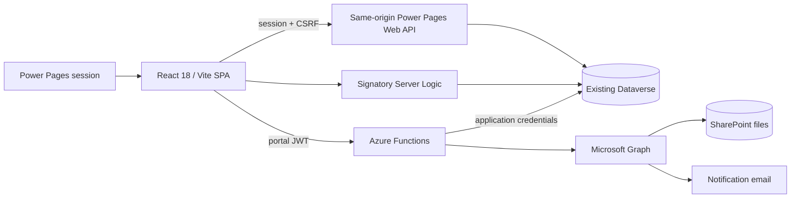

# GCP Nexus application review

**Review date:** 2 October 2026 (Asia/Riyadh). **Source:** `master`, commit `023122933dd6962cf31a7a7b5d6e5edb3757f0f1`. Working tree was clean when review began.

This is a source, repository metadata, dependency, and build review. It is not a signed-in production penetration test or a certification that every deployed component matches Git. Findings below distinguish observed implementation from external conditions that still need verification. No runtime code, permissions, schema, deployment, commits, or remote data were changed.

**Main conclusion:** Restore access to existing submitted information before introducing storage. Both letter bodies already persist, acceptance conclusions and dates already persist, and signature images already have request-linked records. Request Detail hides their entry points after workflow progression. The acceptance form does not have a complete historical snapshot, and current letter viewers regenerate content rather than displaying the persisted submission. Those are separate problems requiring separate fixes.

**First priorities:** correct Web API wildcard configuration, close overly broad authenticated-user access, protect workflow/signature mutations server-side, and expose submitted artifacts through a read-only Request Detail section. No new Dataverse table or column is demonstrably required for that first delivery.

## Review coverage and evidence limits

Reviewed architecture/context documents, route topology, all 13 matter form families and their mapping conventions, create/edit/repair orchestration, request detail and related renderers, verification/review/engagement/acceptance/letter/signature paths, administrative screens, central API helpers, integration Functions, signatory Server Logic, web roles/table permissions/site settings, and focused test coverage. Detailed evidence locations appear in the tables and evidence index below. Static UX inspection covered shared fields, multistep forms, tables, document previews, navigation, and styles.

| Check | Result and limit |
|---|---|
| Existing focused tests | 142 passed on this unchanged source checkout during today's initial project review. Includes workflow, deletion, quota, signatures, metadata, and permission assertions; does not exercise the portal runtime. |
| SPA build | Passed; JS bundle 1,123.71 kB, 296.61 kB gzip. Vite warns about large chunks and mixed static/dynamic imports. |
| Azure Functions build | Passed. `api/npm test` remains a placeholder. |
| npm dependency audits | Frontend: 9 affected packages, 4 high and 5 moderate. Backend: 1 high affected package. These are package counts, not distinct exploitable application defects. Raw JSON accompanies this report. |
| Plugin source scanners | `opengrep` and `trivy` unavailable; that automated scan was skipped. Manual source review and npm audits were performed separately. No comprehensive automated secret scan was completed. |
| Permission schema validator | Returned four UUID-format errors. Its RFC UUID variant restriction flags four existing GUID-shaped IDs; this alone does not prove Dataverse or PAC rejects those records. Verify actual IDs against GCP metadata before changing any identifier. |
| Live Dataverse check | PAC is connected to **StarLinks Development Environment**, environment `ec8b53ba-3e48-e7dd-844b-ad4458656b57`, rather than documented GCP environments. No GCP schema query or environment switch was performed. |
| External checks | Deployed table/column permissions, plugins/flows, SharePoint ACLs/version retention/Defender, portal identity provider, certificate, headers/WAF, live accessibility/mobile behavior, and actual role journeys remain unverified. |

The documented GCP targets are GCP-Developer (`19d73dc4-0f30-e868-bf7d-8abcd4b89699`) and PowerPagesProduction (`f99a8105-8032-ea69-966d-145edf57bc94`). Their current external state is not established by this review.

## A. Application Understanding

GCP Nexus manages contract/procurement submissions through the GCP and GCPC channels. Requestors select a matter, complete a multistep form, upload supporting documents, acknowledge accuracy, and submit a parent request plus matter-specific data. Review participants then verify, schedule engagement, record review decisions, collect signatures, accept the review, and issue acknowledgement or endorsement letters. Administrators manage slots, engagements, user roles, signatories/thresholds, email templates, request deletion, and dashboard reporting.

### Roles and user journeys

| Role | Intended journey and record access | Important implementation qualification |
|---|---|---|
| Requestor | Create; see own requests; edit own New/R/RS requests; repair incomplete New submissions; track results and retrieve documents. | Owner permission currently attaches to Authenticated Users, although create routes require Requestor. Most child tables are globally accessible to authenticated users. |
| Verifier | Read requests; check details/documents; choose permitted verification status; record comment and identity. | Route guard exists; record writes are broadly permitted without a source-visible server workflow-state gate. |
| Reviewer | Read, comment, decide, review resubmissions, complete signature stage, issue GCP acknowledgement. | Review submission has an ETag conflict check; acknowledgement lacks comparable role/status/channel checks at its own page. |
| Working GCPC | Read review material, give suggestions during Draft Review, sign configured prepared/confirmed positions. | Signing matches email in UI; signature create permission is broader than that check. |
| HOC | See company requests, select acceptance conclusion, confirm/draw/upload signature, submit acceptance. | Company check exists in UI; request permission allows company-scoped writes to the table generally. |
| Endorser | Read workflow material and submit GCPC endorsement at Pending Endorse, with legacy status 8 support. | Route/page guard present, but no source-visible atomic transition authorization. |
| Main Committee | Read requests/review outputs. | Global request read is explicitly granted in checked-in metadata. Confirm business scope. |
| Administrators | Manage operational configuration and users; edit/delete requests; handle workflow exceptions. | Most admin routes are gated; Function role changes check admin server-side, but target role writes need site scoping. |
| Authenticated Users | Baseline signed-in access. | Automatically assigned role currently grants substantial business-data access; open registration is enabled in repository settings. |

### Implemented lifecycle

Creation writes New (`1`). Verification offers matter-specific paths: FR (`0`), Ready for Engagement (`2`), RS (`16`), special-project W (`19`), and for some GCP matters Pending Ack (`9`); the current status is also retained as an option. Ready for Engagement is removed for matter values 1/5/10/11/13/14; Pending Ack is added for 10/11/13/14; CPR (12) is restricted to FR plus the current status. Thus some GCP requests reach acknowledgement directly from verification, without HOC acceptance. Booking an engagement creates the engagement, marks the slot booked, then sets the request to R (`3`). Historical Draft Review (`4`) supports suggestions and a review entry point.

Reviewer Code 1 sets Pending Review (`5`) and derives outcome from category/matter. Prepared/confirmed signatory thresholds allow Reviewer/Admin to advance to Complete Review (`6`). HOC acceptance stores conclusion booleans/date and advances GCP to Pending Ack (`9`) or GCPC to Pending Endorse (`11`). GCP acknowledgement finishes at ACK (`10`); GCPC endorsement at E (`12`). Status 8 is retained for legacy acceptance/letter records.

Reviewer Code 2 returns RS (`16`, outcome `4`); Code 3 sets NC3 (`17`) with category-specific NC outcome; Code 4 sets NC4 (`18`); W sets Waived (`19`). These branch away from the ordinary signing/acceptance path. The choice list also contains statuses that are historical or are not written by the principal paths above; a choice's existence does not establish an active transition.

Edit reuses the creation form at New/R/RS. It preserves requestor/company and status. Successful RS edits repair outcome to RS and stamp `gcp_lastupdateddate` after writes, making re-review available. Reviewer final submission checks for intervening edits and uses the observed ETag. Incomplete New parent records are shown as Draft only when integrity checks prove associated data is absent; unknown integrity fails closed.

## B. Current Architecture

The strict TypeScript SPA uses React Router, React Bootstrap, shared business inputs, declarative detail fields, lucide icons, and Recharts. Same-origin CRUD is centralized in `powerPagesApi.ts` and typed services. That client manages anti-forgery tokens, OData construction, retries, and errors. Portal session identity is the authentication source; Function calls acquire an in-memory portal JWT through the same-origin token endpoint. The retired MSAL iframe path is not active.

### Tables and relationships

| Existing logical table | Entity set in source | Relationship / use |
|---|---|---|
| `gcp_request` | `gcp_requests` | Parent business/workflow row; `gcp_RequestorName` to contacts, `gcp_Company` to accounts, `gcp_Project` to projects. |
| `gcp_projects` | `gcp_projectses` | Project/company data and lifecycle; RTP creates Inactive project; FR verification conditionally activates it with ETag protection. |
| `gcp_rtprequest` | `gcp_rtprequests` | RTP child; existing parent relationship `gcp_rtprequest_Request_gcp_request`. |
| `gcp_pblrequest` | `gcp_pblrequests` | PBL child; bidders are grandchildren through `gcp_PBLRequest`. |
| `gcp_pblbidders` | `gcp_pblbidderses` | Bidder identity, sector/contact/source/justification details. |
| `gcp_jvmrequest` | `gcp_jvmrequests` | JVP child (JVM logical prefix); structured collaboration data. |
| `gcp_stsprequest` | `gcp_stsprequests` | Tender/proposal submission details. |
| `gcp_caarequest` | `gcp_caarequests` | Client acceptance of award details; distinct from downstream HOC Review Acceptance. |
| `gcp_pccarequest` | `gcp_pccarequests` | PCCA details and JSON row fields. |
| `gcp_pprequest` | `gcp_pprequests` | Procurement plan child; much basic data lives on parent. |
| `gcp_vaprequest` | `gcp_vaprequests` | Vendor appointment/procurement child. |
| `gcp_otherrequests` | `gcp_otherrequestses` | Shared GCP/GCPC Others table; parent nav is `gcp_Requestlookup`. |
| `gcp_rpccarequestgcp` | `gcp_rpccarequestgcps` | Revised PCCA child; JSON work items; project lookup comes from parent. |
| `gcp_rpprequest` | `gcp_rpprequests` | Revised PP child. |
| `gcp_requestcigcp` | `gcp_requestcigcps` | Contractual issue child. |
| `gcp_cprrequestgcp` | `gcp_cprrequestgcps` | Contract/procurement report child. |
| `gcp_engagements` | `gcp_engagementses` | Links request, slot, creating contact, attendee; dates/times, status, business review number. |
| `gcp_slot` | `gcp_slots` | Availability and attendee configuration. |
| `gcp_signature` | `gcp_signatures` | Each signature event links request/contact and a SharePoint image URL. |
| `gcp_suggestion` | `gcp_suggestions` | Working GCPC suggestions linked through `gcp_Request`; contributor through `gcp_Contact`. |
| `gcp_signatorymember1` | `gcp_signatorymember1s` | Current configured prepared/confirmed roster; threshold configuration uses a sentinel row with `gcp_group` null through Server Logic. |
| `gcp_emailtemplate` | Function/client template services | Notification templates and event configuration. |
| `contact`, `account` | `contacts`, `accounts` | Portal identity, company, lookups/reference data. |

Names above are verified from repository code/metadata, not newly verified against deployed GCP schema. Choice definitions are centralized under `src/data/`; several forms still parse choices with unchecked numeric casts.

Files are uploaded through an Azure Function to SharePoint. Parent `gcp_documentsurl` stores a JSON list of name, URL, optional drive-item ID, field tag, and upload timestamp. Most uploads happen before the parent exists, using a client-generated draft identifier. Signature drawing briefly uses canvas/blob data, uploads PNG/JPEG, then creates a `gcp_signature` row. It does not require Base64 storage in Dataverse.

Azure Functions handle uploads, notifications, web-role administration, and legacy signatory endpoints. Active signatory administration uses same-origin Server Logic with fail-closed administrator checks for writes. No Power Automate cloud-flow definitions or direct cloud-flow calls were found in authored source/site metadata. External Dataverse plugins/flows may still exist; inventory them in the correct environment before changing workflow logic. Liquid/site templates host/configure the SPA; the main business UI is React, rather than duplicated Liquid forms.

## C. Gap Analysis

Priority is the reviewer's remediation priority, not a claim of a successfully exploited deployed vulnerability. **Critical** denotes broad confidentiality/integrity exposure or a current platform compatibility blocker; **High** denotes meaningful workflow/data/audit failure; **Medium** denotes contained operational/UX/technical debt; **Low** denotes optional cleanup. External enforcement may mitigate source omissions and must be checked.

| # | Area | Current Behavior | Gap | Impact | Recommendation | Change Type | Priority |
|---|---|---|---|---|---|---|---|
| G01 | Web API compatibility | Most `Webapi/<table>/fields` settings contain `*`. | Microsoft removed wildcard support for all sites on 14 Sep 2026; repository remains incompatible with current guidance. Live settings unknown. | Potential widespread CRUD failures; future uploads can restore broken settings. | Generate explicit field lists from all GET/filter/order/mutation/lookups; verify against GCP schema and smoke-test all matter paths. Do not guess names or blindly include every column. | Site configuration + code verification; existing columns | Critical |
| G02 | Child/reference access | Most matter children, bidders, engagements, slots, and projects grant Authenticated Users Global read/create/write. Contact Global read also exists. | Child URLs bypass parent ownership/company restrictions; normal users can directly address another record under these permissions if deployed. | Confidential business data exposure, unauthorized edits, slot/project corruption. | Replace broad grants with verified parent/owner/company permissions plus explicit workflow/admin grants. Remove redundant broad grants, because adding narrow grants does not cancel them. | Security/permission configuration; existing relationships | Critical |
| G03 | Workflow integrity | Request owner/HOC/workflow roles can PATCH records; status restrictions live mainly in browser logic. | No source-visible server enforcement of actor, permitted columns, source status, signature threshold, or immutable finalized content. | Owners can bypass UI stage gates; authorized writers can overwrite finalized artifacts or jump stages. | Enforce critical transitions and historical immutability in existing Server Logic/Function/verified Dataverse plugin; constrain direct writes by role/column where supported. | Backend/logic + security; existing table/columns | High |
| G04 | Signature identity | Signature create is Global for signing roles; browser supplies request, contact, name, URL. | Server does not bind creator to signer or validate request eligibility/roster membership. | A valid signed-in signer can submit a signature attributed to another contact/request if permissions permit. | Authoritative signing endpoint derives contact from session, authorizes request/status, validates artifact origin, records one allowed signer event; restrict direct POST. | Backend + permissions; existing signature table | High |
| G05 | Post-submission access | Detail mounts signatures only at status 5; acceptance link only at 6; letters only at active issuance stages. | Submitted forms/letters/signatures disappear from central detail. | Users cannot retrieve business evidence and repeatedly ask staff for copies. | Add persistent read-only Forms & Letters and historical Signatures sections, driven by saved data rather than current action eligibility. | UI/logic; existing columns/tables | High |
| G06 | Letter fidelity | Saved fields contain rendered text plus manual-value metadata; pages regenerate from current template/context. | Auto values, template wording, number, company name, or engagement context can change on revisit. Legacy plain text can be replaced by empty template variables. | Display can misrepresent the submitted letter. | Show saved text before metadata verbatim as escaped plain text. Add future snapshot metadata with resolved values/template revision/actor, retaining legacy parsers. | UI/logic; existing memo columns | High |
| G07 | Acceptance fidelity | Conclusion booleans/date persist; document reads current request and current presentation options; HOC image is a separate earlier event. | No complete accepted-context/declaration/actor/signature-ID snapshot or precise acceptance instant. | Current values cannot prove exact historical form or who pressed final submit. | Freeze future acceptance snapshot as secured SharePoint JSON/PDF referenced in existing documents JSON and saved with conclusion/date/status; label older reconstruction explicitly. | Backend/logic; existing storage/column | High |
| G08 | PBL editing | Edit diff hard-deletes removed bidders after parent/child PATCH. Only Admin bidder delete permission remains. | Ordinary owner/reviewer/verifier removal is still offered but should fail under checked-in permissions. | Partial save followed by 403; legitimate bidder corrections blocked. | Decide permitted editors, verify bidder-to-request relationship, grant scoped delete for those editors or a guarded remove endpoint; preserve Global delete as Admin-only. | Logic + security; existing relationships | High |
| G09 | Acknowledgement route | `/ack-letter` has no route role guard; page does not validate actor/channel/source status before submit. | Button visibility is the primary intended-action guard. | A record writer can submit ACK at an inappropriate stage through direct navigation. | Align acknowledgement with explicit Reviewer/Admin, GCP channel, and allowed source-stage policy; use separate read-only document route and server enforcement. | UI/logic + backend authorization | High |
| G10 | Concurrency | Review/RTP activation use ETags; most edits, acceptance, verification, letters, completion use `If-Match: '*'`. | Pre-read and PATCH are not atomic; stale tabs can overwrite newer decisions. | Lost updates and incorrect workflow progress. | Retain observed request ETag; use conditional mutations and explicit conflict UI. Apply server transition checks, not just another pre-read. | Logic/backend; existing ETags | High |
| G11 | Creation/edit partial saves | Parent/child/bidder/project writes are sequential. Repair handles missing New children. | Partial ordinary edits and ambiguous creates still have no complete operation reconciliation. | Mixed old/new values, orphan projects, duplicate requests/bidders on retry. | Keep operation IDs/state, reconcile existing records before retry, show what saved, resume missing steps; use a verified atomic backend path for critical compound mutations if needed. | Logic/backend; existing tables | High |
| G12 | Engagement booking | Create engagement, mark slot booked, then set request R; checks are client-side. | No atomic slot reservation or compensation if a later write fails. | Double booking; engagement exists while slot/request says otherwise. | Guard booking server-side with current slot/request status and ETags; compensate/reconcile failures and derive review number authoritatively. | Backend/logic; existing records | High |
| G13 | History | AuditTrail component exists but is not mounted. Suggestion load/display is limited to Draft Review. | No central lifecycle history; earlier suggestions disappear after progress; latest fields overwrite earlier cycles. | Weak traceability and incomplete request understanding. | Mount corrected timeline and retrieve saved suggestions beyond active stages; include actors/real engagement numbers and clear error states. Do not call latest-field timeline a complete audit log. | UI/logic; existing tables/fields/audit configuration | High |
| G14 | Signature history | Active signing panel is driven by current roster; request signature list returns oldest-first and HOC chooses first usable `HOC` row. | Roster/name changes can hide past signers; multiple HOC rows do not identify which acceptance used. | Misleading signature history and wrong-image selection. | Historical viewer iterates persisted events; future acceptance stores selected signature ID/group/name/declaration snapshot. Preserve current signing panel as separate action surface. | UI/logic; existing records/snapshot storage | High |
| G15 | Notification authority | Function validates token but trusts caller event/request ID; application credentials read request and send mail. | No per-request/event/transition authorization or replay prevention in source. | Repeated or false lifecycle notifications for another known request. | Authorize caller/request/event server-side; derive event from saved transition, add idempotency/rate limits and reliable delivery status. | Backend/security; existing request data | High |
| G16 | Upload authority | Function accepts caller entity type/request/draft identity after authentication. | No owner/request/status authorization or portal-specific storage boundary. | Cross-request folder writes, storage abuse; shared-environment isolation risk. | Authorize existing requests; issue contact/portal-bound draft upload sessions for pre-save files; isolate destinations and reconcile draft-to-request association. | Backend/security; existing SharePoint storage | High |
| G17 | File validation | Allowed reported MIME bypasses filename extension fallback check. | Caller-controlled MIME permits unsupported filenames; no verified content validation. | Unsafe uploads can enter document storage; actual malware/execution impact depends on SharePoint controls. | Require allowed extension and compatible verified format; confirm Defender/quarantine controls and signature-specific content rules. | Backend/security | High |
| G18 | Document access | SPA opens SharePoint URLs directly. | Dataverse request permission does not govern independent SharePoint ACLs; visibility and retention unknown. | Authorized portal readers may fail to open files; an overly broad SharePoint grant may leak them. | Verify both access systems; use existing ACLs where sufficient, otherwise a request-authorized document endpoint with trusted item lookup and no arbitrary URL proxy. | Security/backend; existing files/IDs | High |
| G19 | Role administration | Admin check/role listing are site-aware; assignment/removal accepts any role GUID. | Mutation does not resolve target role within current website. | Admin of one site may change another site's roles in a shared org. | Validate target role belongs to resolved caller site on both assignment and removal; protect privileged-role changes and log outcome. | Backend/security; existing role records | High |
| G20 | Pagination correctness | Detail takes first child/bidder page; engagements lists cap pages at 100/200; SlotManagement uses first list result. | History and edit baselines can be incomplete; PBL default child page size is 25. | Missing bidders/sessions/slots; justification/diff can use incomplete data. | Follow nextLink for bounded per-request collections or expose paging. Do not edit an incomplete collection. Reuse slot-delete pagination pattern. | Logic; existing services | High |
| G21 | Request search | Filters/date range operate on fetched items; more server pages require Load More. | Search can appear empty while matching older records were never loaded. | Users conclude requests are missing; misleading totals/pagination. | Translate filters to escaped server queries, reset cursors, fetch matching pages, distinguish loaded vs matching totals. | Logic/UI; existing indexed columns | Medium |
| G22 | Polling feedback | ACK and reviewer handlers ignore `pollRequestStatus` false; endorsement reconciles uncertain writes; HOC checks false. | Success/navigation behavior is inconsistent when status confirmation fails. | Users see successful transition without confirmed observable state, then retry or lose context. | Shared mutation result policy: saved, confirmed, uncertain; reconcile both payload and state and show truthful retry guidance. | Logic/UI | Medium |
| G23 | Retry safety | Central API retries 429/5xx for all methods including POST. | Ambiguous server failure after create can cause repeat creates; reusable signatures use read-before-create only. | Duplicate requests, signature events, or bidder rows. | Method-aware retries; reconcile non-idempotent operations or use backend idempotency. Hard cross-tab uniqueness requires verified backend/alternate key capability. | Logic/backend; existing data first | High |
| G24 | Draft survival | Text state uses unversioned form-key sessionStorage; upload Files/URLs and draft ID live in component state. | Refresh restores text but loses pending/file association; draft not scoped to user. Letters/acceptance choices have no persistent draft or leave guard. | Lost work, orphan files, stale identity after account switch. | User-scoped/versioned draft manifest for serializable state/upload references, explicit expiry/cleanup and unsaved-change warning. Keep edit mode outside new drafts. | UI/logic/backend cleanup | Medium |
| G25 | Upload quota/retention | 100 MiB quota correctly combines newly selected files in UI; edits exclude persisted files. Removed links and deleted requests leave files. | Aggregate quota is bypassable by direct Function calls; no established orphan/retention policy. | Storage growth, abuse, uncontrolled audit artifact lifetime. | Preserve approved frontend rule; add server accounting/rate limits where needed, draft cleanup and explicit retention that protects submitted artifacts. | Backend/configuration; existing storage | Medium |
| G26 | Form/detail parity | RTP persists Remarks in parent/child, but its focused detail override includes only four registration fields. Other detail groups are flattened by label. | Remarks is missing on revisit; duplicate child records can be silently collapsed. | Submission information unavailable or ambiguous. | Add persisted Remarks and acknowledgement; maintain per-matter display coverage and show multiple children as anomaly/record groups. | UI/logic; existing columns | High |
| G27 | Validation | Custom multistep validation checks selected required fields; financial/work-item rows largely store JSON/numeric text without complete business validation. | Native required/min attributes are not sufficient for button-driven steps; cross-row/date/length rules lack a common boundary. | Invalid business data or late Dataverse failures. | Define confirmed business rules in shared pure validators; validate all steps at final submit and backend critical inputs; add field-focused errors. Avoid inventing required business rules. | UI/logic/backend; existing fields | Medium |
| G28 | Dashboard correctness/performance | Separate count query per KPI/category/matter/status; category/matter null counts become zero. | Roughly 40 count calls per mount; failed data looks like a true zero in some charts. | Throttling, slow reports, misleading business reporting. | Render unknown/error explicitly; dedupe/cache count queries, narrow selects and use supported aggregate backend path only after validation. | Logic/UI/backend optional | Medium |
| G29 | Identity hydration | AuthContext resolves contact by email top 1 despite portal contact identity being available in types. Broad contact read supports lookup. | Duplicate/changed/missing email can bind wrong or absent contact; client identity is used for signing/lookups. | Failed owner/HOC flows, possible misattribution; unnecessary personal-data visibility. | Prefer verified portal contact GUID with self read; remove email fallback dependency where possible; backend derives signer independently. | Logic/security; existing contact ID | High |
| G30 | Error handling | HOC signature load and some review/suggestion/history reads convert failure to empty/null. Malformed documents JSON becomes empty. | Cannot distinguish absent data from inaccessible/broken data. | Users may re-sign or think evidence vanished; support diagnosis difficult. | Explicit empty/failed/unknown states, safe retry, preserve raw storage for diagnosis, report parsing/schema version failures. | UI/logic | Medium |
| G31 | Authentication/config exposure | Repository enables local login/open registration, high invalid-attempt limit, inner errors, and broad data roles. | Intended invite/identity policy and deployed overrides unverified; detail errors and debug logs expose information. | Enlarged attack surface and diagnostic/personal-data exposure. | Verify approved registration policy, tighten access first, review provider/contact mapping/throttling, disable production inner errors, remove PII debug logging. | Security/configuration/code | High |
| G32 | Dependencies | npm audit flags 9 frontend/1 backend packages; MSAL remains unused dependency. | Security updates not reflected in lockfiles; toolchain advisories and runtime advisories need distinct treatment. | Development-machine exposure; potential runtime routing issues; maintenance burden. | Upgrade compatible fixes first, plan required major upgrades, validate routes/builds, do not run audit fix --force blindly. Remove unused MSAL separately. | Dependency/code maintenance | High |
| G33 | Accessibility/navigation | Shared fields/icons largely labelled; NumberField lacks described-by linkage; shell has no skip link; step errors do not move focus. Several navigation controls are buttons. | Keyboard/screen-reader flow and standard open-in-new-tab behavior are incomplete. | Users can miss errors or lose place in long forms. | Add main ID/skip link, consistent error association, focus first invalid field/step heading, use Links for navigation; audit focus/contrast/targets. | UI-only/shared components | Medium |
| G34 | Mobile/document UX | A4 form/letter views and dense financial/bidder tables; image/PDF previews lack explicit failure recovery. | Small-screen/SharePoint embed behavior is unverified; failed previews can appear blank. | Difficult reading/signing on mobile or inability to retrieve documents. | Keep printable A4 view, offer responsive summary and horizontal table wrappers; preview loading/error with Open fallback; test touch/keyboard at 320/375 px and zoom. | UI-only | Medium |
| G35 | Technical boundaries | All routes imported eagerly; detail hook loads matter children even for letter/acceptance pages; repeated service/parser/choice patterns remain. No app error boundary or catch-all route. | Large initial bundle, unnecessary queries, white-screen/unmatched-route risk. | Slow initial load and difficult debugging. | React.lazy route chunks, parent-only artifact retrieval, small shared policy/collection helpers, boundary with safe recovery and 404. Preserve business form abstractions. | Logic/code refactoring | Medium |
| G36 | Dates and audit actors | Acceptance uses Malaysia calendar date; ACK/E dates use UTC date; signature event time differs from final acceptance time. No letter submitter stored explicitly. | Date-only cannot supply an exact instant; request modifiedon/by is latest mutation, not per-document submit evidence. | Confusing chronology and unsupported 'Submitted By' claims. | Standardize business date handling; future snapshot stores authoritative UTC timestamp and contact actor. Show unknown historical actor honestly. | Logic/backend; existing snapshot storage | Medium |
| G37 | Deletion/history retention | Admin deletion removes bidders/child/parent but intentionally not workflow/SharePoint records; slot deletion compensates link changes best-effort. | Retention/cascade outcome depends on external relationships; uncertain failures and concurrent rebinds can affect history. | Evidence loss/orphans or rollback overwriting newer links. | Document retention policy, review deployed cascade rules, restrict destructive deletion for finalized requests per approved policy, use ETag-safe compensation and truthful partial results. | Backend/logic/security policy; existing records | Medium |
| G38 | Tests/documentation/operations | Focused Node tests exist but context says no suite and latest commit July; mapping still says JVP/STSP files display-only although current forms persist tagged links. Machine-local files tracked; no visible CI pipeline. | Conflicting onboarding/deployment assumptions and thin signed-in journey coverage. | Future changes regress mappings/permissions or deploy stale config. | Correct dated docs/mapping, add build/focused-test/audit CI and signed-in role matrix; review local-file tracking without printing secrets. Keep historical decisions. | Docs/tooling/testing | Medium |

Platform evidence for G01: Microsoft states wildcard removal was effective **14 September 2026**, and Web API requests using `*` fail until explicit fields are configured. This is a current configuration risk, not proof the live GCP site is already failing. [Power Pages deprecations](https://learn.microsoft.com/en-us/power-pages/important-changes-deprecations), [Web API settings](https://learn.microsoft.com/en-us/power-pages/configure/web-api-overview).

## D. Forms & Letters Analysis

### Acknowledgement Letter

**Current storage:** `gcp_request.gcp_acklettertextcontent`; date in `gcp_acknowledgementdate`; submission sets `gcp_requeststatus = 10`. The text includes the resolved human-readable body and `GCP_LETTER_METADATA_V2:` JSON containing template key and manual values. Legacy HTML-comment metadata remains supported.

**Current behavior:** generated/editable document, freeform required body, confirmation, submit PATCH and status poll. Request Detail link is only shown to Reviewer/Admin at status 8/9; it disappears at ACK. Direct route lacks its own authorization/state/channel guard. Stored data is available in the default request GET, but the viewer reconstructs from current template/request, rather than using stored text as its historical source.

**Missing:** reliable per-letter submitter, precise authoritative submission instant, template revision, explicit full resolved-value snapshot, immutable presentation artifact. The rendered stored text does preserve submitted wording/auto values, so no new column is needed to show that wording now. Unsaved frontend edits are temporary.

**Least invasive solution:** a read-only viewer uses the stored rendered-text prefix, safely separated from the recognized V2/legacy suffix. Render as text, not HTML. Preserve undecodable legacy text with a warning rather than silently falling back to a new template. Show saved date and an unknown submitter when no evidence exists. Future writes extend the same versioned metadata with actor/time/template revision/resolved values; keep the stored rendered body authoritative. If exact visual reproduction is required, retain a generated artifact in existing SharePoint storage and tag its existing documents link.

**Retrieval/permissions/editability:** request-authorized readers can view the saved letter through Request Detail at later statuses, independent of issuance roles. Reviewer/Admin may compose only on authorized GCP stages. Finalized letters remain read-only. A future correction should create a separately retained snapshot/reference and explicit revision, rather than overwrite history; old letters cannot be retrospectively versioned without evidence.

### Endorsement Letter

**Current storage:** `gcp_request.gcp_endorselettertextcontent`, `gcp_endorsementdate`, status E (`12`), same rendered-text/metadata convention. Review No. derives from most recent Completed engagement through existing `gcp_engagements.gcp_engagementnumber`.

**Current behavior:** Endorser/Admin route/page checks; allowed source 11 or legacy 8; required-variable checks and confirmation; uncertain writes reconcile by observing E status. Detail action disappears after endorsement. Original Requestors and read-only roles cannot use the issuance route as their historical viewer because its route guard excludes them. Historical display also unnecessarily depends on a fresh engagement lookup.

**Missing:** actor/time/revision metadata as above. Current engagement number/company/template can change after save, although the original rendered values already survive in the memo body. Reconciliation of status alone does not prove the attempted body was the body committed when competing writers exist.

**Least invasive solution:** same persisted-text viewer as ACK, without engagement lookup or template regeneration for historical reads. Future submit performs conditional authorized transition and compares saved artifact identity/body when reconciling. Freeze resolved Review No. in metadata; retain the existing engagement source for new compositions.

**Permissions/editability:** all request-authorized readers may view; Endorser/Admin issuance remains stage/channel-limited. Submitted artifact is read-only. New versions use existing SharePoint/documents references only when a business correction workflow is approved.

### Acceptance Form (downstream HOC Review Acceptance)

**Current storage:** `gcp_request.gcp_reviewconclusioncode1a`, `gcp_reviewconclusioncode1b`, `gcp_reviewconclusioncode1bcomment`, `gcp_reviewconclusioncode2`, `gcp_reviewconclusioncode3`, and `gcp_acceptancedate`. New writes clear legacy 1b and save selected 1a/2/3; status advances to 9/11. HOC image is a `gcp_signature` row with `gcp_name = HOC`, request lookup, optional signer contact lookup, URL, and createdon.

**Current behavior:** the shared `ReviewDecisionForm` already supports completed read-only/print display on its route. The detail link exists only at status 6, and route access is HOC/Admin, so most authorized request viewers cannot reach that historical presentation. Signing persists before final acceptance; a signed status-6 form remains resumable. The displayed request context and wording are regenerated, and signature selection picks the first usable HOC row for the request.

**Missing:** selected signature row binding to this exact final submission, actor who submitted, precise submit time, frozen request/review context, declaration wording/version, and all resolved document values. Existing flags/date plus image allow a useful reconstruction, not proof of exact historical acceptance. Sign date is not submit date. Never use the current viewer's name as a historical signer fallback.

**Least invasive solution:** initially expose a pure read-only acceptance renderer from persisted flags/date plus request-linked HOC events, mark it **Reconstructed from saved request data** where no snapshot exists. For future submissions generate a versioned acceptance JSON snapshot containing resolved request values, conclusion, declaration, selected signature ID/URL/contact/name, actor and authoritative time. Store it in existing secured SharePoint storage; reference it in `gcp_documentsurl` with a documented new field tag, such as `acceptanceForm`. That tag is an application JSON convention, not a proposed Dataverse column. PATCH the reference, flags/date and target status together under ETag/server authorization after storage succeeds. Failed final PATCH leaves an unsubmitted/orphan artifact eligible for cleanup, rather than claiming completion.

**Permissions/editability:** viewing follows request access. Only company HOC/Admin may submit while status 6; the server must enforce that. Prior submission is immutable. A later cycle should create a new artifact reference, preserving previous ones; do not confuse latest conclusion flags with full multi-cycle history. Client Acceptance of Award (CAA) is a separate matter form and should retain its own detail mapping.

### Signature

**Current storage/capture:** draw canvas or upload validated PNG/JPEG, maximum 5 MiB in UI; upload Function sends image to SharePoint; `gcp_signature.gcp_signurl` stores URL. `gcp_Request` links request and `gcp_Signatory` links contact; `gcp_name` is email or HOC marker; Dataverse createdon is the per-request signing event timestamp. Reuse makes a fresh request signature event while retaining the existing image URL. There is no need to add Base64 to Dataverse or duplicate the image binary.

**Missing post-submission functionality:** Request Detail renders the action panel only at Pending Review. A historical roster-independent gallery is absent. Current roster changes affect whose boxes/counts are shown. Contact formatted names are current values; actor/name/declaration at signing time are not frozen. No verified unique key makes concurrent confirmations atomic. Image immutability/SharePoint versioning is unknown.

**Least invasive solution:** load all authorized request-linked events with paging, display image, saved contact/name-or-email fallback, createdon as **Signed On**, signer type only when evidenced, and document/acceptance association when stored. Separate confirmed request events from reusable previews; never count/show a reusable preview as a historical signature. Future snapshot captures signer/group/declaration context and selected event ID. Use existing immutable image URLs/versions where supported; verify retention/access before relying on them.

**Permissions/editability:** parent request scope for reads, plus an identity-safe endpoint for a signer to retrieve their own reusable image across authorized historical contexts. Do not maintain global signature visibility merely to support reuse. A signer may confirm/draw/upload only when the server sees eligibility. Persisted events remain append-only; removal/replacement requires an explicit correction policy.

## E. Recommended Request Detail Design

Use **Option B: a consolidated Forms & Letters section**, with read-only document pages for long printable content and inline/expandable summaries for signatures and history. This fits existing `DetailSection`, document cards, route-based workflow pages, and A4 print styles. A small modal can show metadata, but long letters/acceptance should use a dedicated viewer so mobile scrolling, deep links, and printing work reliably.

Recommended order: Request Information and Classification; Current Status/Next Action; Matter Details; Approvals/General Review; Forms & Letters; Attachments; Signatures; Activity/History. Reuse the existing cards rather than redesigning working form pages. Render only relevant saved artifacts or meaningful pending steps.

| Artifact | State source | Attribution/date | Action |
|---|---|---|---|
| Acknowledgement | Saved ACK text/date; if contradictory to current workflow, label **Saved — submission state needs verification**. | Snapshot actor if available, otherwise Not recorded; existing date labelled date-only. | View Saved Letter, Print; text download is optional. |
| Endorsement | Saved E text/date, same consistency treatment. | Snapshot actor/time when available. | View Saved Letter, Print. |
| Review Acceptance | Frozen artifact when present, else persisted flags/date reconstruction. | Signature identity is Signed By; final submitter unknown unless separately captured. | View Submitted Form, Print; reconstructed label where needed. |
| Signatures | Persisted current-request `gcp_signature` events. | Bound contact/email and createdon; unknown identity labelled honestly. | View Image; restricted download according to business policy. |

Viewing policy is **can read this request**; mutation policy separately evaluates role, company, source status, and operation. Use an existing-style route such as `/requests/:id/documents/:kind` only as a proposed new frontend route. Route guards load authorized parent first; do not load unrelated signature/SharePoint records by a supplied ID. Authorized request readers include owner, matching-company HOC, configured review/endorser/committee roles, and administrators according to approved scope. A denied/error response does not become **Not submitted**.

For exact letters, display saved rendered text as the first release. It preserves content but not pixel-identical original layout. Reusing live templates for aesthetic formatting must not silently substitute current values. An exact visual archive requires a saved PDF/document or a frozen renderer version. Print/Save as PDF can be offered immediately without claiming that it is an already archived PDF.

## F. Existing Data Model Reuse

| Existing table/columns or resource | Recommended reuse | Limit |
|---|---|---|
| `gcp_request.gcp_acklettertextcontent`, `gcp_endorselettertextcontent` | Authoritative stored letter text, backward-compatible versioned metadata for future actor/time/resolved values. | Confirm memo maximum lengths in deployed schema; do not assume unlimited snapshots. |
| `gcp_acknowledgementdate`, `gcp_endorsementdate`, `gcp_acceptancedate` | Existing document business dates. | Date-only values do not establish precise UTC submission time. |
| `gcp_reviewconclusioncode1a/1b/2/3`, `gcp_reviewconclusioncode1bcomment` | Reconstruct saved HOC decision; maintain legacy reading. | Mutable latest values; no frozen contextual form. |
| `gcp_request.gcp_documentsurl` | Existing document-link JSON with field tags/IDs; reference acceptance or optional archived-letter snapshots. | Add typed/versioned application descriptors, document conventions, and field length checks; never stuff binaries into this memo. |
| Existing SharePoint drive/library | Image reuse; secure JSON/PDF snapshots and existing attachments. | Current ACLs, versions, retention and portal access must be verified. No new document-management table needed. |
| `gcp_signature.gcp_signatureid`, `gcp_name`, `gcp_signurl`, `createdon`, lookups `gcp_Request`, `gcp_Signatory` | Historical signed events; associate selected signature ID with future acceptance snapshot. | Existing rows do not prove the full declaration/context or final acceptance submitter. |
| `gcp_request.gcp_requeststatus`, `gcp_outcome`, `gcp_decisioncode` | Current workflow/progress and consistency checks. | Cannot reconstruct all historical transitions. |
| `gcp_reviewdate`, `gcp_verifydate`, `gcp_verifier_comment`, `gcp_reviewercomments`, `gcp_infoandcriteriaforreview`, `gcp_lastupdateddate` | Timeline/current review evidence and RS cycle readiness. | Last saved values, not immutable event history. |
| Existing verified/reviewed contact lookups `gcp_Verified_by`, `gcp_Reviewedby` | Attribution for verification/review where stored. | Reviewer is not necessarily acknowledgement submitter; Endorser identity is not recorded by letter PATCH. |
| `gcp_engagements.gcp_engagementnumber`, `gcp_engagementdate`, `gcp_engagementstatus`, `gcp_EngagementCreatedBy`, existing request/slot lookups | Real session history and new-letter Review No. | Fetch every relevant page; preserve historical snapshot value after issuance. |
| `gcp_suggestion` existing request-linked data | Show review suggestions after Draft Review. | Verify intended readership; some roles lack current read grants. |
| RTP child `gcp_projectdescription` and parent `gcp_projectdiscription` | Restore submitted Remarks in detail. | Preserve spelling and existing mappings. |
| `createdon`, `modifiedon`; Dataverse audit/activity data if enabled | Show record creation/update and support investigations. | They are record-level metadata; do not infer each letter submitter/time from latest modification. Verify portal actor semantics and audit availability. |
| `contact` and `account` existing IDs/relationships | Portal identity/company scope and display lookup. | Current formatted names are not immutable name snapshots. |

**Notes/Annotations:** no authored Notes/Annotation integration, table permissions, or verified attachment relationship was found. Therefore Notes is a possible future reuse candidate only after live inventory, not an established available storage path. Do not invent an annotation relationship or grant Global annotation access. Existing SharePoint/documents storage already fits the minimal solution. Avoid commandeering `gcp_notes` or legacy `gcp_signature` parent memo without an established purpose/size/access contract.

## G. Required Data Model Changes

**None are presently established as required.** Existing memo fields and existing SharePoint/document-reference storage can support viewing and future snapshots; existing tables/relationships can support narrower authorization. This review does not authorize a schema change.

Potential conditional changes, only after exhausting existing storage and verifying deployed schema:

| Conditional requirement | First use existing capability | When a minimal schema addition might be justified |
|---|---|---|
| Search/report directly by letter submitter and precise submission time | Authoritative actor/time in existing letter/snapshot metadata; existing audit where available. | Only if Dataverse views/reporting require indexed/filterable columns and metadata/audit cannot meet it. Propose a small actor/date set; obtain schema-owner confirmation; no logical names invented here. |
| Hard guarantee of one event per request/signer/cycle | Atomic authorized signing endpoint with idempotency and concurrency control. | A confirmed alternate key or equivalent schema constraint if server strategy cannot satisfy required uniqueness. Request+signer alone may be wrong when multiple cycles are allowed. |
| Unlimited indexed version history | Append secured immutable artifacts/references in current storage, with size/retention limits. | A version table only if required scale/query/retention cannot be met by existing references/storage and verified audit. This is not required for basic read-only retrieval. |

No new form-specific tables, file columns, Base64 columns, or duplicate signature tables are recommended.

## H. Security & Permission Gaps

G02–G04 and G15–G19 are the most substantial source/metadata findings. Existing narrow parent permissions do not protect globally granted child records. Most non-RTP children should inherit owner/company visibility through verified existing request relationships, with explicit global review access only for roles whose business scope requires it. Bidders should inherit through PBL, signatures through request, and authorized reusable-image lookup through signed-in identity. Account/contact reference access should expose only required fields and intended readers.

For every change, trace **read/create/update/delete plus association/disassociation**, and evaluate the union of all roles/grants. Signature child needs Append and request/contact target needs Append To for its lookup associations. Confirm this against live metadata and current platform behavior; a plugin audit skill's prose must not override verified Dataverse association semantics. Do not enable broad grants to clear a 403. [Dataverse association privileges](https://learn.microsoft.com/en-us/power-platform/admin/how-record-access-determined).

The create-route comment says Requestor-only create, but `Request-Owner-Access.tablepermission.yml` currently associates Authenticated Users. Correct the policy/configuration mismatch after confirming intended rights, while ensuring HOC, signatory and reviewer reads/writes still work. Open registration plus baseline Global business permissions compounds the exposure. No anonymous table permission association was observed; this is principally authenticated-user overreach.

Explicit Web API fields define exposed columns, not per-role or status-dependent workflow authorization. For role-sensitive workflow columns, verify the active authorization model: classic portal column permissions and enhanced-authorization column security profiles are different mechanisms. **Enhanced Data Model does not by itself establish Enhanced Authorization.** Conditional stage validation still belongs at an authoritative mutation boundary. [Table permissions](https://learn.microsoft.com/en-us/power-pages/security/table-permissions), [Column permissions and authorization-model caveat](https://learn.microsoft.com/en-us/power-pages/security/column-permissions).

Function JWT validation verifies portal key/signature/issuer/audience/contact and role administration checks admin server-side. Those controls should be preserved. Authentication alone does not authorize upload/notification operations for a particular request. Signatory Server Logic admin checks fail closed; retain them. No verified token-forgery bypass was found.

SharePoint access is independent: a URL is not proof of authorization, nor proof of anonymous accessibility. Do not add public links to make portal previews work. If a document endpoint is needed, resolve request and trusted drive item from persisted request data, validate same authorized request, reject arbitrary URLs/item IDs, and avoid leaking storage credentials. Test copied URLs in another user's session and unauthenticated session.

Live headers, CSP, WAF, certificates, provider authority, registration overrides, and SharePoint policies were not measured. Repository `HTTP/X-Frame-Options = SAMEORIGIN` and disabled profile redirect are observed; missing settings do not prove live defaults are insecure. Confirm CSP compatibility with Power Pages iframe hosting and trusted SharePoint frames before tightening it.

## I. Code / Technical Gaps

Retain the existing architecture. It has useful typed table services, canonical choice mirrors, shared business inputs, same-form edit reuse, repair integrity batching, upload quota helpers, ETag-aware review/project activation, and narrow administrator delete permissions. Improvements should extend these patterns.

Concrete refactoring targets: extract a pure saved-letter parser/view model and read-only artifact renderer; split Request Detail/acceptance data loading so artifact pages do not fetch all children; reuse paginated collection helpers; centralize transition policies and result reconciliation; add operation-safe retries; replace unchecked choice casts with existing `parseChoiceValue`; share form draft/upload orchestration without replacing per-matter business mappings. Keep the GCP and GCPC document wording independent while sharing proven storage/viewer behavior.

Technical checks found no authored `dangerouslySetInnerHTML` use and no evidence that large duplicate Liquid business forms are running alongside React. Suggested cleanup of template/choice duplication is targeted, not a recommendation for an architectural rewrite. Hard-coded schema/choice constants that mirror verified metadata are legitimate; current roster names/CC recipients and duplicated workflow integers deserve configuration/policy review, but changing them must not alter submitted historical wording.

### Dependency audit interpretation

| Project | npm-reported packages | Practical interpretation |
|---|---|---|
| SPA | High: browserslist, nanoid, postcss, vite. Moderate: @remix-run/router, baseline-browser-mapping, esbuild, react-router, react-router-dom. | Build/dev-tool issues are distinct from runtime routing issues. This application is a client SPA, so a React Router SSR-hydration advisory does not establish an applicable exploit here. Inspect each path before assigning application exposure. |
| Functions | High: brace-expansion. | Confirm dependency chain/dev-only pruning and deployed artifact; not proof the upload HTTP handler processes hostile brace expansions. |

Raw audit JSON is in `application-review-2026-10-02-npm-spa.json` and `application-review-2026-10-02-npm-api.json`. Example primary advisories: [Vite Windows deny bypass](https://github.com/advisories/GHSA-fx2h-pf6j-xcff), [React Router open redirect](https://github.com/advisories/GHSA-2j2x-hqr9-3h42), [brace-expansion resource exhaustion](https://github.com/advisories/GHSA-mh99-v99m-4gvg). npm recommends a major Vite change for some findings; assess compatibility rather than automatically applying it. No dependencies were changed.

## J. UX Gaps

The strongest UX improvement is durable access to submitted evidence, with explicit saved vs reconstructed vs unconfirmed states. Keep active workflow actions separate from historical views. Display current stage, who can act next, relevant pending forms, and a central history; avoid treating every unused status choice as a step everyone must complete.

Other concrete UX fixes are G21, G24, G26–G28, G30, G33–G34: complete search, refresh-safe draft references, missing RTP Remarks, field-level validation/focus, unknown dashboard values, load error recovery, and mobile document readability. Do not replace the existing working forms simply to modernize their appearance.

Static accessibility observations against [Web Interface Guidelines](https://raw.githubusercontent.com/vercel-labs/web-interface-guidelines/main/command.md):

- `src/components/Layout.tsx:9`: add focusable main target and skip link.
- `src/forms/NumberField.tsx:47`: connect help/error IDs with aria-describedby, consistent with TextField.
- `src/forms/multistep/MultiStepForm.tsx:96`: failed step validation announces an error but does not focus the invalid field; step navigation needs predictable focus.
- `src/components/detail/DocumentPreviewModal.tsx:68`: image lacks explicit dimensions and load/error state; retain safe Open fallback for failed embeds.
- `src/pages/RequestDetail.tsx:1129`: route-navigation action uses button/navigate; Link supports keyboard and open-in-new-tab conventions.
- `src/styles/theme.css:2359`: transition: all should name properties; verify component-specific motion reduction. Existing reduced-motion rules mean the site is not universally missing motion support.

Many existing icons, dynamic-table controls and modal actions already have accessible labels; signature image upload provides an alternative to drawing. These strengths should be preserved. Real focus order, contrast, zoom, screen-reader announcements, PDF embedding, touch signing and small-screen overflow still need runtime testing; no visual compliance score is asserted.

## K. Recommended Implementation Plan

### Phase 1 — No Data Model Changes (required work)

1. **Establish safe baseline:** verify GCP-Developer environment and live schema/config/plugins/flows; export/read current permissions, column exposure and SharePoint policy. Fix wildcard field lists and critical scope problems using only verified existing columns/relationships. Validate every role's CRUD and Append/Append To needs. Production changes require separate explicit authorization.
2. **Restore historical retrieval:** add Forms & Letters registry/view models based on parent fields and signature events. Add request-authorized read-only viewer routes, stored-text parsing with V2/legacy/plain-text coverage, permanent links at later statuses, and complete signature/history pagination. Restore RTP Remarks and show saved suggestions. Reuse pure renderers and print styles.
3. **Protect mutations:** implement authorized stage/actor/company checks and ETags for acknowledgement, endorsement, acceptance and signature completion. Separate read permission from issuance permission; make signatures identity-bound; fix scoped PBL bidder removal. Reconcile unknown results and constrain non-idempotent retries.
4. **Freeze future evidence:** extend letter metadata in existing memo fields with resolved context/version/actor/authoritative time. Add acceptance snapshot to existing secure SharePoint storage and persist tagged document reference in the final request PATCH. Preserve existing signature image/event IDs; do not duplicate binaries. Older records remain clearly reconstructed/actor unknown unless reliable audit evidence proves otherwise.
5. **Repair operational risks:** upload/draft authorization and content checks; notification event authorization/idempotency; site-scoped role mutations; booking reservation/recovery; explicit error states. Add scoped/versioned draft references and cleanup/retention policy.
6. **Validate and document:** focused behavior tests plus SPA/Function builds; signed-in dev role smoke tests; correct mapping/context docs. Evaluate dependency fixes and add CI. No deployment until authorized; production follows successful developer validation and explicit confirmation.

Phase 1 acceptance criteria: authorized owner/HOC/review readers can reopen completed request and view saved artifacts; unrelated users cannot retrieve them by request/signature/file URL; active actions retain correct role/stage gates; saved letter remains byte-equivalent in displayed content after template/request changes; historical acceptance clearly distinguishes snapshot/reconstruction; unknown reads never appear as absent; duplicate/conflicting submissions produce truthful state; PBL edits and >25-bidder cases work correctly.

### Phase 2 — Minimal Schema Changes (conditional, not yet required)

Measure existing memo/reference capacity and reporting needs after Phase 1. Consider only the narrowly justified cases in section G: indexed actor/time reporting, confirmed event uniqueness requirements, or version-query scale beyond current storage. Produce schema-owner proposal with verified metadata, alternatives and migration/backfill limits before requesting a change. Never fabricate old submitter/time values.

### Phase 3 — Optional Enhancements

Archived exact-layout PDFs, document hashes/retention locking using existing storage capabilities, approved revision workflow, engagement/calendar reminders, richer reporting/aggregates, selective route splitting, responsive summaries, and expanded audit export. Prioritize features whose business benefit is confirmed. None needs a new document-management architecture by default.

### Signed-in validation matrix before release

| Scenario | Expected result |
|---|---|
| Owner revisits ACK/E with submitted artifacts | Saved content remains available and read-only even though issuance action is gone. |
| Another Requestor guesses request/child/signature/item ID | Denied at data/backend boundary; no document/image leakage. |
| HOC same vs different company | Matching company can view/accept as permitted; different company denied. |
| Reviewer/Verifier/Endorser/Main Committee | Reads match approved scope; each can mutate only assigned operations/stages. |
| Signatory spoofs another contact or signs final request | Server rejects; own reusable preview does not count until authorized current-request confirmation. |
| Legacy marker/plain-text letter and legacy acceptance Code 1b | Historical stored text remains intact; legacy decision labels mapped without rewriting source history. |
| Template/request/contact name/roster changes after submit | Saved artifact remains frozen; reconstructed records clearly labelled. |
| PBL 26+ bidders and owner removes a bidder | Full collection displayed/edited; removal authorized narrowly and no partial silent success. |
| Two tabs accept/sign/book/edit simultaneously | Conditional conflict or idempotent reconciliation; no false completion/double reservation. |
| Network loss after PATCH/POST, partial child writes, invalid JSON, 403, preview failure | Uncertain/partial/error states visible; retry does not blindly duplicate or overwrite. |
| Mobile 320/375 px, 200% zoom, keyboard/screen reader, print | Readable summary/table overflow, focused errors, labelled controls, usable upload alternative, printable saved document. |
| Upload >quota, malformed MIME/extension, unowned draft/request; repeated notification | Server policies enforce approved limits/ownership/events; no unauthorized sends/writes. |

## Evidence index

Paths/lines identify current evidence; line numbers may shift after implementation.

| Findings | Source evidence |
|---|---|
| G01 | `.powerpages-site/site-settings/Webapi-gcp_request-fields.sitesetting.yml:4` and other table fields settings; current Microsoft links in section C. |
| G02/G03/G31 | `CAA-Request-Global-Access.tablepermission.yml`, other non-RTP Global child permissions; `Contact-Global-Read`, `Project-Global-Access`, `Slot-Global-Access`, `Engagement-Global-Access`, `Request-Owner-Access`, `Request-HOC-Company-Read`, `Signature-Global-Read` under `.powerpages-site/table-permissions/`; registration/innererror site settings. |
| G04/G14/G23 | `src/shared/services/signatureService.ts:208` (oldest-first list), `:237` (caller-provided create), `:264` (read-before-create), `:314` (complete-review PATCH); `src/components/signatures/SignatureSection.tsx:208` (live roster/counts); `ReviewDecisionForm.tsx:127` (HOC selection). |
| G05/G13/G26 | `src/pages/RequestDetail.tsx:130` (RTP override), `:324` (draft-only suggestions), `:1109` (status-only signature mounting), `:1123` (acceptance action), `:1140` (issuance action); `src/components/detail/AuditTrail.tsx` exists/exported but no route/page mounting found. |
| G06/G07/G36 | `src/components/letters/LetterDocument.tsx:39` (auto wins), `:88` (only manual metadata); `letterPersistence.ts:1`; `src/types/request.ts:342` (memo/date selects); `src/shared/acceptReviewPayload.ts:11`; `ReviewDecisionForm.tsx:313` (viewer-name fallback). |
| G08/G11 | `src/forms/pbl/api.ts:238` and `:271`; `src/shared/services/pblBidderService.ts:112`; `PBL-Bidders-Global-Access.tablepermission.yml` vs `PBL-Bidders-Admin-Delete.tablepermission.yml`. |
| G09/G10/G22 | `src/App.tsx:90`; `src/pages/AckLetterPage.tsx:141`; `src/shared/services/requestService.ts:567`; `src/pages/RequestReview.tsx:259`; `ReviewDecisionForm.tsx:263`; `EndorsementLetterPage.tsx:214`. |
| G12/G37 | `src/pages/Engagement.tsx:263` (create/slot/request sequence), `:310` (swallowed slot reopening error); `src/shared/services/slotService.ts:306`; `requestDeletionService.ts:121`. |
| G15 | `api/src/functions/sendNotificationEmail.ts:57`, `:71`, `:98`, `:121`; `api/src/dataverse/requests.ts:74`. |
| G16/G17/G25 | `api/src/functions/uploadFile.ts:81`, `:104`, `:114`, `:120`, `:137`; `api/src/config.ts:37`; `src/shared/uploadQuota.ts`; `src/shared/uploadApi.ts`. |
| G18/G30 | `src/shared/documents.ts:43`; `src/components/detail/DocumentPreviewModal.tsx:68`; `src/components/signatures/SignatureModal.tsx:224`; `ReviewDecisionForm.tsx:138`. |
| G19 | `api/src/dataverse/webRoles.ts:112`, `:122`; `api/src/functions/manageWebRoles.ts:159`. |
| G20/G21/G28 | `src/shared/hooks/useRequestDetail.ts:82`; `src/shared/services/childRequestList.ts:66`; `engagementService.ts:39`, `:71`; `src/pages/SlotManagement.tsx:86`; `src/pages/Requests.tsx:121`, `:175`; `src/pages/Dashboard.tsx:93`. |
| G24/G27/G29 | `src/forms/multistep/useFormDraft.ts:3`; `src/forms/rtp/RtpForm.tsx:130`; JVP/STSP upload state/collectNewDocuments; `src/context/AuthContext.tsx:85`; `src/shared/services/contactService.ts:33`; `src/forms/pcca/PccaForm.tsx:433`, `src/forms/rpcca/RpccaForm.tsx:388`. |
| G32/G35/G38 | `package.json`, `api/package.json`, audit JSON; `src/App.tsx:5`, `src/main.tsx:17`; `PROJECT_CONTEXT_REPORT.md`; `mapping.md:112`, `:142` compared with `JvpForm.tsx:640` and `StspForm.tsx:670`; `git ls-files` confirms local/generated artifacts tracked. |

Used workflows: [Power Pages security-review](/C:/Users/Administrator/.codex/plugins/cache/power-platform-skills/power-pages/2.6.2/skills/security-review/SKILL.md), inline permission/config analysis, Web Interface Guidelines, React best practices, and evidence-before-completion. The separate security HTML is an inventory report; manually assessed priorities are in section C here, not fabricated scanner severities.
